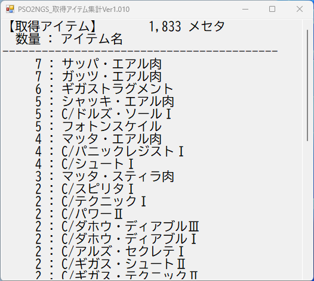

# PSO2NGS 取得アイテム集計ツール

PSO2 NGS で拾ったアイテムとメセタを、ツールを起動してからの分だけ自動で集計して表示するツールです。
周回の成果確認に便利です。



> [!NOTE]
> これは個人が作成した**非公式ツール**です。株式会社セガおよび PSO2 NGS 運営とは一切関係ありません。
> ゲームのファイルやメモリには一切触れず、ゲームが出力するログファイル（テキスト）を読むだけです。

## できること

- ツール起動**後**に拾ったアイテムだけを集計（起動前の分は数えません）
- 拾ったメセタの合計を表示
- アイテムを数量が多い順に表示
- 2秒ごとに自動更新
- 常に最前面に表示されるので、ゲーム画面の横に置いておける
- `Ctrl + A` で全選択してコピー可能（記録を残したいときに）
- レスタサイン・リバーサーサインは集計から除外

> [!TIP]
> 日付が変わるなどでゲームのログファイルが新しくなると、集計はそこからやり直しになります。

## 使い方

1. [Releases](../../releases) から最新の `PSO2NGS_GetItemViewer.exe` をダウンロード
2. 好きなフォルダに置いてダブルクリックで起動
3. 「新規ドロップを待機中...」と表示されたら準備完了。あとはいつも通り遊ぶだけです

> [!WARNING]
> PowerShell から作成した EXE のため、ウイルス対策ソフトに**誤検知**されることがあります。
> 気になる場合は、下の「.ps1 を直接使う」方法でソースコードのまま実行できます。中身はすべてこのページで確認できます。

### 設定を変える（任意）

`config.example.ini` を EXE と同じフォルダに置き、名前を `config.ini` に変えて編集してください。
置かなくても標準の設定で動きます。

| 項目 | 内容 |
| --- | --- |
| `LogPath` | ログフォルダの場所（通常は不要） |
| `FontType` / `FontSize` | 表示フォントと文字サイズ |
| `FormSize_X` / `FormSize_Y` | ウィンドウの幅と高さ |

※ `config.ini` は **BOM付き UTF-8** で保存してください（メモ帳なら「UTF-8 (BOM 付き)」）。

### .ps1 を直接使う

1. `PSO2NGS_GetItemViewer.ps1` をダウンロード
2. PowerShell で次を実行（ダウンロードしたファイルのブロックを解除します）
   ```powershell
   Unblock-File .\PSO2NGS_GetItemViewer.ps1
   ```
3. 右クリック →「PowerShell で実行」

## EXE の作り方（開発者向け）

[PS2EXE](https://github.com/MScholtes/PS2EXE) を使っています。

```powershell
Install-Module -Name ps2exe -Scope CurrentUser
ps2exe -inputFile ".\PSO2NGS_GetItemViewer.ps1" `
       -outputFile ".\PSO2NGS_GetItemViewer.exe" `
       -iconFile ".\icon.ico" `
       -title "PSO2NGS取得アイテム集計ツール" `
       -description "ツール起動後からのドロップアイテムとメセタを集計します" `
       -version "1.0.0.0" `
       -noConsole
```

## 動作環境

- Windows 10 / 11
- Windows PowerShell 5.1（Windows に標準で入っています）

## ライセンス

[MIT License](LICENSE)
